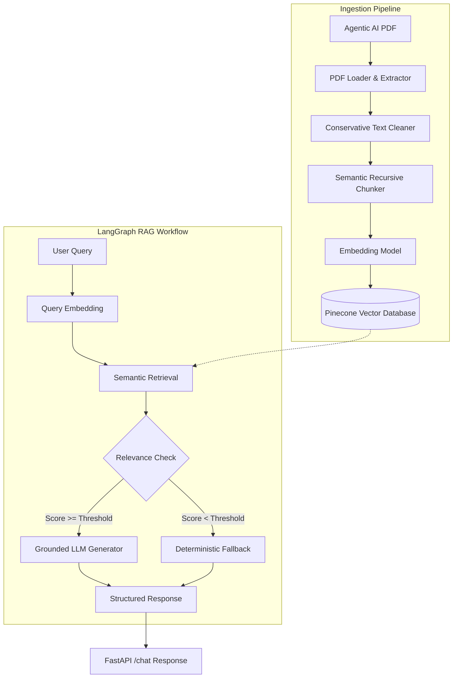

# Agentic AI eBook — Grounded RAG Chatbot

A production-quality Retrieval-Augmented Generation (RAG) system engineered in Python to answer user queries strictly from the official **Agentic AI eBook** ([https://konverge.ai/pdf/Ebook-Agentic-AI.pdf](https://konverge.ai/pdf/Ebook-Agentic-AI.pdf)) with zero hallucination.

Orchestrated using **LangGraph**, backed by **Pinecone** vector database, and served through a modern **FastAPI** REST interface.

---

## Architecture Overview



---

## Project Structure

```
RAG/
├── app/
│   ├── __init__.py
│   ├── config.py              # Pydantic Settings with validation & safe defaults
│   ├── main.py                # FastAPI app initialization, lifespan, CORS, error handling
│   ├── api/
│   │   ├── __init__.py
│   │   ├── routes.py          # /health, /info, /chat route handlers
│   │   └── schemas.py         # Pydantic schemas (HealthResponse, ChatRequest, ContextChunk)
│   ├── ingestion/
│   │   ├── __init__.py
│   │   ├── loader.py          # PDF acquisition & 1-indexed page text extraction
│   │   ├── chunker.py         # Conservative cleaner & recursive semantic chunker
│   │   └── embedder.py        # Modular embeddings (OpenAI, Gemini, Local Mock)
│   ├── rag/
│   │   └── __init__.py        # LangGraph workflow orchestration (Phase 4)
│   └── vectorstore/
│       ├── __init__.py
│       └── pinecone_store.py  # Pinecone index management, batch upsert & query
├── scripts/
│   ├── __init__.py
│   └── ingest.py              # End-to-end ingestion CLI script
├── tests/
│   ├── __init__.py
│   ├── test_api.py            # API health & settings validation tests
│   └── test_retrieval.py      # PDF extraction, chunking, embedder, and vector store tests
├── data/                      # Cached PDF storage (gitignored)
├── docs/                      # Technical documentation
├── .env.example               # Environment variables template
├── .gitignore                 # Excludes venv, .env, PDFs, and build caches
├── requirements.txt           # Pinned dependencies for Python 3.12+
├── README.md                  # Project overview & documentation
└── LICENSE                    # MIT License
```

---

## Document Ingestion & Chunking Rationale

The knowledge base PDF contains **60 pages** (~78,800 characters) across 6 major sections.

- **Cleaning Strategy**: Conservative normalization that standardizes line endings, strips non-printable control characters, replaces typographic quotes, and collapses whitespace while preserving semantic paragraph boundaries (`\n\n`).
- **Chunking Strategy**: Recursive character chunking with:
  - **Chunk Size**: `800 characters` (~130–160 words). Fits cohesive concepts, definitions, and architecture components without overflowing embedding attention or diluting similarity scores.
  - **Chunk Overlap**: `150 characters` (~20–25 words). Ensures boundary definitions and cross-sentence meaning are preserved across chunk splits.
  - **Deterministic IDs**: Formatted as `agentic-ai-p{page:02d}-c{chunk_index:02d}` for traceability and citation.
- **Yield**: Exactly **149 chunks** across 60 pages (average 2.5 chunks/page, 587.7 characters/chunk).

---

## Setup & Quickstart

### 1. Environment Setup
```powershell
# Create and activate virtual environment
python -m venv .venv
.\.venv\Scripts\Activate.ps1

# Install pinned dependencies
pip install -r requirements.txt
```

### 2. Configure Environment Variables
Copy `.env.example` to `.env` and fill in credentials:
```powershell
cp .env.example .env
```
Key variables:
- `PINECONE_API_KEY`: Your Pinecone API key
- `PINECONE_INDEX_NAME`: `agentic-ai-rag`
- `PINECONE_NAMESPACE`: `agentic-ai-ebook`
- `EMBEDDING_PROVIDER`: `openai` or `gemini` or `local`
- `LLM_PROVIDER`: `openai` or `gemini`

### 3. Run Ingestion Pipeline
To ingest the PDF into Pinecone:
```powershell
python -m scripts.ingest
```

To test the ingestion pipeline offline without upserting:
```powershell
python -m scripts.ingest --dry-run
```

### 4. Run Automated Tests
```powershell
pytest -v tests/
```

---

## Implementation Progress

| Phase | Milestone | Status |
|---|---|---|
| **Phase 1** | Workspace analysis, environment inspection, architecture blueprint | **Completed** |
| **Phase 2** | Project foundation, settings, API skeleton, `/health` endpoint | **Completed** |
| **Phase 3** | PDF acquisition, extraction, chunking, embeddings, Pinecone integration | **Completed** |
| **Phase 4** | LangGraph RAG workflow, relevance guardrail, grounded generation | *Pending* |
| **Phase 5** | FastAPI `/chat` endpoint integration & error handling | *Pending* |
| **Phase 6** | End-to-end question evaluation & hallucination testing | *Pending* |
| **Phase 7** | Comprehensive interview notes & architecture guide | *Pending* |
| **Phase 8** | Final code review & submission preparation | *Pending* |
