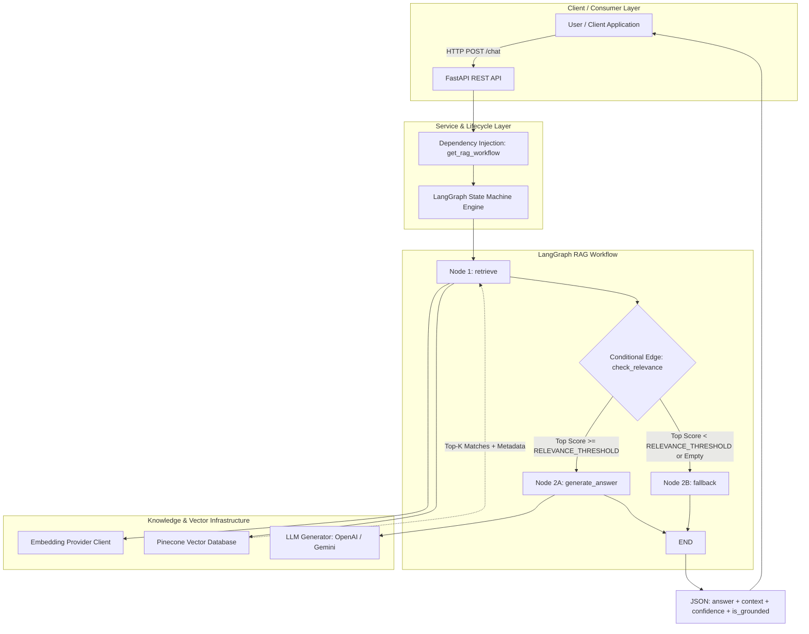
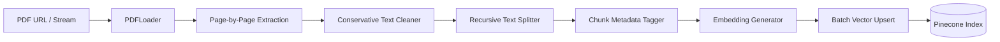

# Technical Architecture — Agentic AI eBook Grounded RAG Chatbot

This document details the software architecture, state machine flow, data pipelines, failure modes, and engineering decisions implemented in the **Agentic AI eBook Grounded RAG Chatbot**.

---

## 1. System Topology



---

## 2. Ingestion Pipeline Architecture



### Components
1. **`PDFLoader` (`app/ingestion/loader.py`)**:
   - Downloads `https://konverge.ai/pdf/Ebook-Agentic-AI.pdf` into `./data` cache.
   - Validates PDF magic header (`%PDF-`).
   - Extracts text page-by-page (1-indexed) using `pypdf.PdfReader`.
   - Identifies and logs blank or graphic-only pages (e.g. Page 1 cover).
2. **`TextChunker` (`app/ingestion/chunker.py`)**:
   - **Cleaning**: Normalizes linebreaks (`\r\n` $\to$ `\n`), standardizes smart typographic quotes (`\u2018`, `\u2019` $\to$ `'`), cleans unicode conversion artifacts (`\ufffd`), collapses multi-space tabs while strictly preserving double newlines (`\n\n`) for paragraph boundaries.
   - **Chunking Strategy**: Recursive character splitting with hierarchical separators: `\n\n` $\to$ `\n` $\to$ `. ` $\to$ ` `.
   - **Parameters**: `chunk_size = 800 characters`, `chunk_overlap = 150 characters`.
   - **Deterministic IDs**: `agentic-ai-p{page:02d}-c{index:02d}` (e.g. `agentic-ai-p08-c01`).
3. **`BaseEmbedder` (`app/ingestion/embedder.py`)**:
   - Uniform abstraction supporting OpenAI (`text-embedding-3-small`), Gemini (`gemini-embedding-001`), and deterministic Mock embeddings.
   - Enforces batching and programmatically verifies vector dimension.
4. **`PineconeStore` (`app/vectorstore/pinecone_store.py`)**:
   - Serverless index management (`ServerlessSpec`).
   - Namespace isolation (`PINECONE_NAMESPACE`).
   - Batched upserting with deterministic vector IDs and rich metadata payload.

---

## 3. LangGraph State Machine Specification

### State Contract (`RAGState`)
```python
class RAGState(TypedDict):
    user_query: str
    retrieved_documents: List[Dict[str, Any]]
    retrieval_scores: List[float]
    context: str
    confidence: float
    should_answer: bool
    answer: str
    error: Optional[str]
```

### Node Mechanics
| Node | Input State Fields | Output State Mutation | Execution Logic |
|---|---|---|---|
| **`retrieve`** | `user_query` | `retrieved_documents`, `retrieval_scores`, `context`, `confidence`, `should_answer` | Embeds query, fetches top-k chunks from Pinecone, computes confidence heuristic, sets `should_answer = bool(docs and max(scores) >= RELEVANCE_THRESHOLD)`. |
| **`check_relevance`** | `should_answer` | Branch choice | Router function returning `"generate_answer"` if `True` else `"fallback"`. |
| **`generate_answer`** | `user_query`, `context` | `answer` | Formats strict grounding prompt, executes zero-temperature LLM generation with `[Page X]` citations. |
| **`fallback`** | N/A | `answer` | Returns fixed refusal message: *"I couldn't find sufficient information about this in the provided Agentic AI knowledge base."* **Bypasses LLM completely.** |

---

## 4. Grounding & Anti-Hallucination Guarantees

1. **Relevance Gating**: Queries lacking strong vector similarity ($< 0.65$) never trigger generative inference. This cuts off hallucination before generation starts.
2. **Strict Grounding Prompt**:
   - Instructs model: *"Answer ONLY using the facts directly stated in the RETRIEVED CONTEXT below. Do NOT use outside knowledge."*
   - Demands exact refusal string if context is incomplete.
3. **Adversarial Neutralization**:
   - Prompts instructing the agent to "ignore the document" or "use general knowledge" are constrained by system instructions that enforce document adherence.
4. **Transparent Confidence**:
   - Explicitly calculated as:
     $$\text{confidence} = \text{round}(\max(0.0, \min(1.0, \max(\text{scores}))), 4)$$
   - Documented as a retrieval similarity heuristic, never a calibrated probability of factual truth.

---

## 5. Failure Modes & Graceful Degradation

| Failure Mode | Trigger Condition | System Behavior | HTTP Response |
|---|---|---|---|
| **Invalid Input** | Empty or whitespace query | Pydantic validator rejects input | `422 Unprocessable Entity` |
| **Out-of-Scope Query** | Top cosine similarity $< 0.65$ | Relevance gate routes to `fallback` node | `200 OK` (Safe refusal message) |
| **Empty Retrieval** | No vectors returned | Relevance gate routes to `fallback` node | `200 OK` (Confidence: 0.0) |
| **Pinecone Unavailable** | Network drop or unconfigured key | Catches exception, logs warning, returns empty doc list $\to$ triggers fallback | `200 OK` (Fallback refusal) |
| **LLM Provider Outage** | Quota exhaustion / 5xx error | Caught in `generate_answer`, sets fallback answer, logs error | `200 OK` (Fallback refusal) |
| **Unexpected Crash** | Unhandled internal exception | Global FastAPI exception handler catches error | `500 Internal Server Error` (No leaked tracebacks) |
